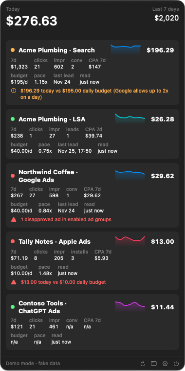
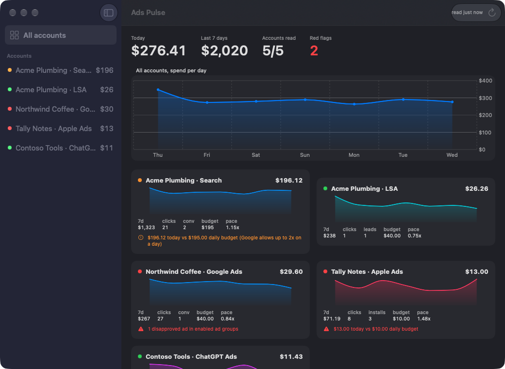
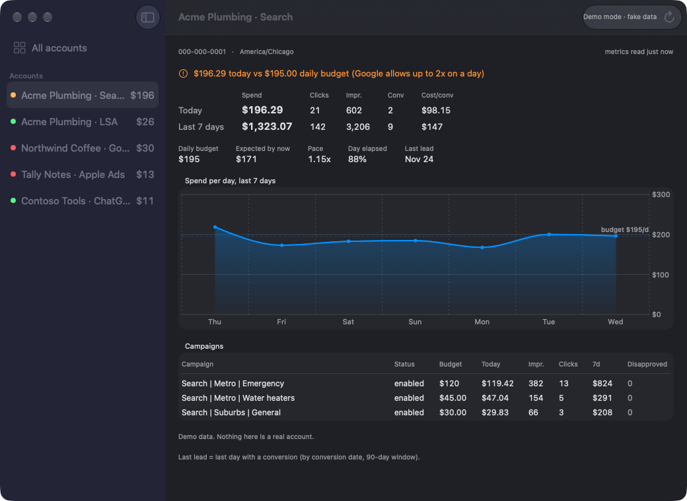
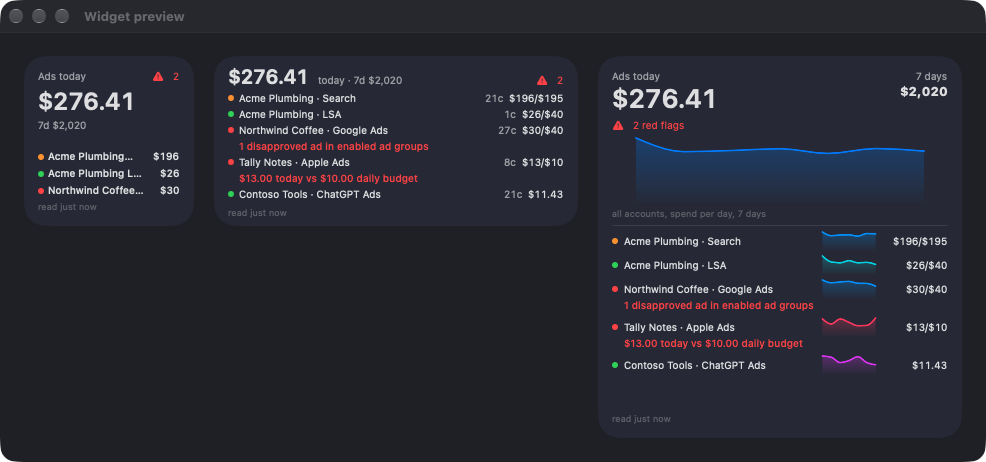

# Ads Pulse

Today's ad spend for every account you run, in your Mac's menu bar, a Dock window and desktop widgets.

Ads Pulse is two small pieces:

- **A macOS app** (SwiftUI + WidgetKit, macOS 14+). It polls one HTTPS endpoint every 60 seconds and shows today's spend, the last 7 days, budget pacing and red flags.
- **A reference server** (Node, no framework). It reads Google Ads, Google Local Services Ads, Apple Ads and ChatGPT Ads with **your own** credentials and returns that endpoint. Use it as-is, or write your own server that returns [`schema.json`](schema.json).

It starts in **demo mode** with fake data, so you can try it before connecting anything.

| Menu bar | Window |
|---|---|
|  |  |





*All screenshots are demo mode. Every account, campaign and number in them is made up.*

## What it shows

For each account:

- **Today and the last 7 days.** Spend, clicks, impressions, conversions and cost per conversion. Conversions are leads for LSA and installs for Apple Ads.
- **Budget pacing.** The daily budget, what you'd expect to have spent by now, and how far ahead or behind you are.
- **A 7-day spend trend**, one point per day.
- **Campaigns.** Status, budget, today's numbers and disapproved ads.
- **Last lead.** The exact time for LSA; for Google Ads, the last day with a conversion.
- **When each number was read.**

Red flags:

- **Over budget pace:** 1.5x or more ahead of pace, once at least a quarter of the budget is spent.
- **Over the daily budget.** Google Ads may spend up to 2x a daily budget on one day, so over 1x is amber there and red above 2x.
- **0 impressions today** on an enabled, serving campaign after 9 AM account time.
- **Disapproved ads** in enabled ad groups.
- **A failed read.** A number that could not be read is shown as `n/a`, never as `$0`.

## Run the app

Ads Pulse is **not notarized** yet: there is no signed download. Build it from source. It takes about a minute.

```sh
brew install xcodegen          # once
cd app
./scripts/build.sh             # ad-hoc signed build in app/build/
INSTALL=1 ./scripts/build.sh   # same, then copy to /Applications and launch
```

- **Ad-hoc signing** needs no Apple developer account. It runs on the Mac that built it. Other Macs will block it with Gatekeeper unless you remove the quarantine flag.
- **Signing with your team** (Apple Development certificate):

  ```sh
  TEAM_ID=ABCDE12345 ./scripts/build.sh
  ```

  Add `ASC_KEY_PATH`, `ASC_KEY_ID` and `ASC_ISSUER_ID` (an App Store Connect API key) to let `xcodebuild` create the provisioning profiles without signing in to Xcode.
- **Bundle ID:** set `BUNDLE_ID_PREFIX` to use your own (default `com.example`).

**Add the widget:** right-click the desktop, choose **Edit Widgets**, search for **Ads Pulse**, and pick small, medium or large.

**Connect your endpoint:** in the app, open **Settings** (the gear in the menu-bar dropdown, or ⌘,).

1. Turn off demo mode.
2. Enter your endpoint URL and token.

The URL is stored in the app's preferences. The token is stored only in your login Keychain, never in a file. HTTPS is required; `http://localhost` is allowed for testing.

How the pieces fit:

- The app writes each response to `~/Library/Application Support/AdsPulse/pulse.json`.
- The widget is sandboxed and reads only that folder, read-only. It never touches the network or the token.
- Keep the app running (Settings has **Open at login**) so the widgets stay current.

## Run the server

```sh
cd server
npm install
cp .env.example .env     # fill in what you use; see below
npm test
ADS_PULSE_TOKEN=$(openssl rand -hex 32) ADS_PULSE_DEMO=1 npm start   # fake data on http://localhost:8787/api/ads-pulse
```

Read it:

```sh
curl -H "Authorization: Bearer $ADS_PULSE_TOKEN" http://localhost:8787/api/ads-pulse
```

**Deploy:**

- **Any Node 20+ host:** run `npm start` (`node --env-file=.env` works too) behind HTTPS.
- **Vercel:** import the `server/` folder as a project and set the environment variables. `api/ads-pulse.ts` becomes `https://<your-project>.vercel.app/api/ads-pulse`.

Responses are cached in memory for 5 minutes (`ADS_PULSE_CACHE_SECONDS`). Add `?fresh=1` to skip the cache; the app's refresh button does that.

### Credentials

Every setting is an environment variable. [`server/.env.example`](server/.env.example) lists the names. Only `ADS_PULSE_TOKEN` is required; any platform you don't configure is simply left out.

| Platform | Variables | Notes |
|---|---|---|
| Google Ads | `GOOGLE_ADS_DEVELOPER_TOKEN`, `GOOGLE_ADS_CLIENT_ID`, `GOOGLE_ADS_CLIENT_SECRET`, `GOOGLE_ADS_REFRESH_TOKEN`, `GOOGLE_ADS_ACCOUNTS` | Accounts as `1234567890:Label,2345678901:Other`. Set `GOOGLE_ADS_LOGIN_CUSTOMER_ID` to your manager (MCC) id if the accounts sit under one. |
| Local Services Ads | `GOOGLE_ADS_LSA_ACCOUNTS` (same format) | Leads become conversions. LSA accounts get no `login-customer-id` header by default. If any account is **not** under your MCC, list the ones that are in `GOOGLE_ADS_MCC_CHILDREN`. A wrong header fails with an authorization error that looks like a revoked credential. |
| Apple Ads | `APPLE_ADS_CLIENT_ID`, `APPLE_ADS_TEAM_ID`, `APPLE_ADS_KEY_ID`, `APPLE_ADS_ORG_ID`, `APPLE_ADS_PRIVATE_KEY` (or `_PATH`) | API access is set up in Apple Ads under Account Settings > API. The server signs a fresh ES256 client secret on every read. |
| ChatGPT Ads | `OPENAI_ADS_API_KEY` | Account-level spend, clicks and impressions. The reporting API has no daily budget. |

All reads are **read-only**. The server never changes a campaign.

## Use your own server

Any HTTPS endpoint works if it:

- accepts `Authorization: Bearer <token>`, and
- returns JSON matching [`schema.json`](schema.json): `totals` plus one object per account, with today, last 7 days, an optional 7-day `trend`, budget and pace, campaigns, flags and read times.

`server/src/core.ts` has the same contract as TypeScript types, plus the pacing and flag rules if you want to reuse them.

## Repository layout

```
app/       macOS app: App/ (window, menu bar, settings), Widget/, Shared/ (models, client, demo data, charts)
server/    reference server: src/core.ts (schema + rules), src/read.ts (platform reads), src/server.ts, api/ads-pulse.ts
schema.json
```

## License

MIT. See [LICENSE](LICENSE).
